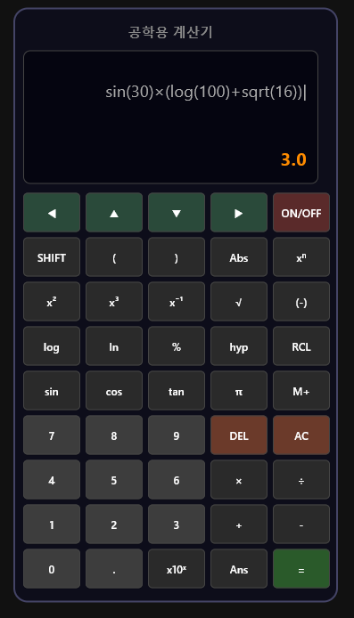
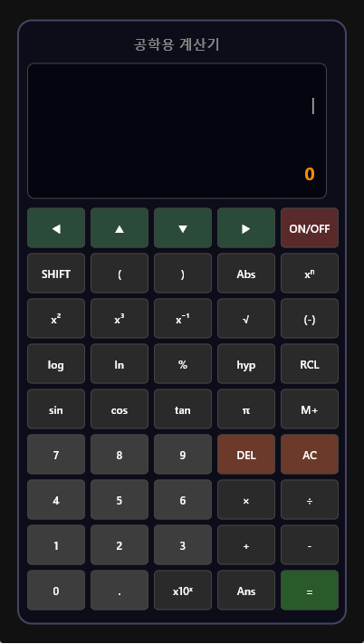
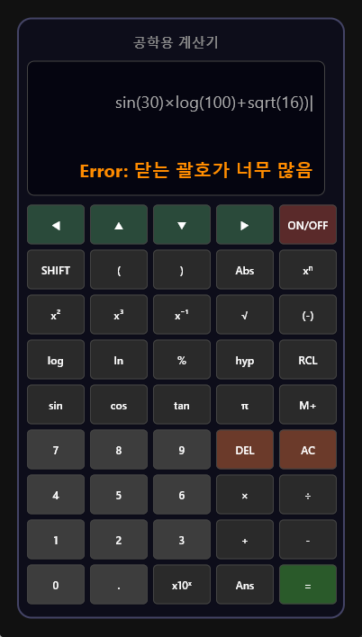
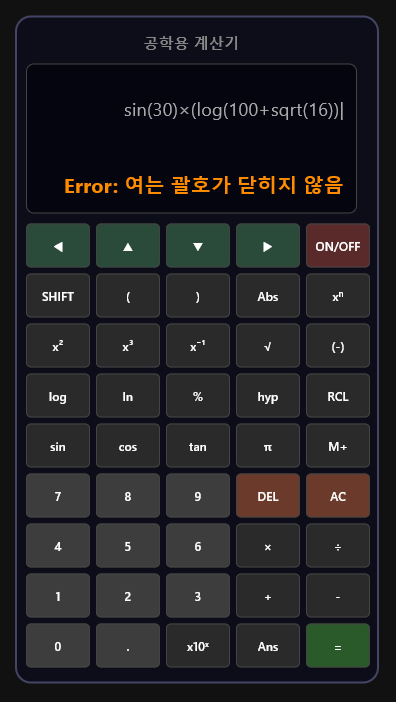

# 공학용 계산기 &nbsp;&nbsp;&nbsp;&nbsp;&nbsp;&nbsp;&nbsp;&nbsp;&nbsp;<small><small><small>2026.06</small></small></small>

Python과 Flet으로 만든 공학용 계산기.

CASIO 공학용 계산기의 UI를 참고해 설계했고, 입력한 수식을 전처리해 삼각, 로그, 거듭제곱 등 함수를 계산.




## 핵심 코드

### 수식 계산

[engineering_calculator.py](engineering_calculator.py) · [이론 정리: 함수와 lambda](https://github.com/Jenny5789/python/blob/main/study_archive/theory/08_functions.md) · [자료형(dict)](https://github.com/Jenny5789/python/blob/main/study_archive/theory/03_data_types.md)

화면 수식(예: `2^3×sin(30)`)의 기호를 파이썬 문법으로 바꾸는 전처리 후, 허용한 함수만 쓰도록 제한한 `eval`로 계산.

```python
# 허용 함수만 담은 딕셔너리 (일부)
SAFE_FUNCTIONS = {
    'sin':  lambda x: math.sin(math.radians(x)),   # 각도(degree)로 입력받도록 감쌈
    'log':  math.log10,
    'sqrt': math.sqrt,
    # ... 생략
}

def preprocess(expr: str) -> str:
    expr = expr.replace("^", "**")                 # 2^3 → 2**3
    expr = expr.replace("×", "*")
    expr = re.sub(r'(\d+)!', r'factorial(\1)', expr)   # 5! → factorial(5)
    # ... 생략
    return expr
```

### 오류 처리

[engineering_calculator.py](engineering_calculator.py) · [이론 정리: 예외 처리](https://github.com/Jenny5789/python/blob/main/study_archive/theory/13_exceptions.md)

계산 전에 괄호 짝부터 검사하고, 오류 종류마다 다른 메시지를 화면에 표시.

```python
def calculate(expr: str) -> str:
    try:
        bracket_error = check_brackets(expr)       # 괄호 검사 먼저
        if bracket_error:
            return bracket_error

        processed = preprocess(expr)
        # 내장 함수를 비우고 허용 함수만 넘겨 실행 범위 제한
        result = eval(processed, {"__builtins__": {}}, SAFE_FUNCTIONS)
        if isinstance(result, float) and result.is_integer():
            return str(int(result))
        return str(round(result, 10))
    except ZeroDivisionError:
        return "Error: 0으로 나눌 수 없음"
    except SyntaxError:
        return "Error: 수식 오류"
    # ... 생략
```

## 주요 기능

| 기능 | 설명 |
|---|---|
| 연산 | 사칙연산, 괄호, 거듭제곱, 루트, 상용로그(log), 자연로그(ln)<br>팩토리얼(n!), eˣ, x10ˣ, Abs, %, π |
| 삼각, 쌍곡선함수 | SHIFT로 역삼각함수, hyp로 쌍곡선함수 전환 |
| 수식 편집 | 방향키로 커서 이동 후 중간 수정, DEL, AC<br>커서 위치 기준 문자열 슬라이싱([줄 편집기](https://github.com/Jenny5789/python/blob/main/study_archive/data_structures/02_line_editor.py)) |
| 기록과 메모리 | 위, 아래 방향키로 이전 계산식, M+, RCL, Ans<br>상태와 기록은 [list, dict](https://github.com/Jenny5789/python/blob/main/study_archive/theory/03_data_types.md)로 관리 |
| 오류 메시지 | 괄호 오류, 0으로 나눌 수 없음, 정의되지 않은 값(예: 음수의 루트), 수식 오류 |

<details>
<summary>전체 화면 보기</summary>

| 시작 화면 | 괄호 오류 1 | 괄호 오류 2 |
|---|---|---|
|  |  |  |

</details>

## 파일 구조

```
engineering_calculator/
├── engineering_calculator.py   # 수식 전처리, 계산, UI 전체
├── images/                     # README 스크린샷
└── README.md
```

## 실행 방법

Python 3.x, Flet 0.80.0 이상.

```
pip install flet
python engineering_calculator.py
```
